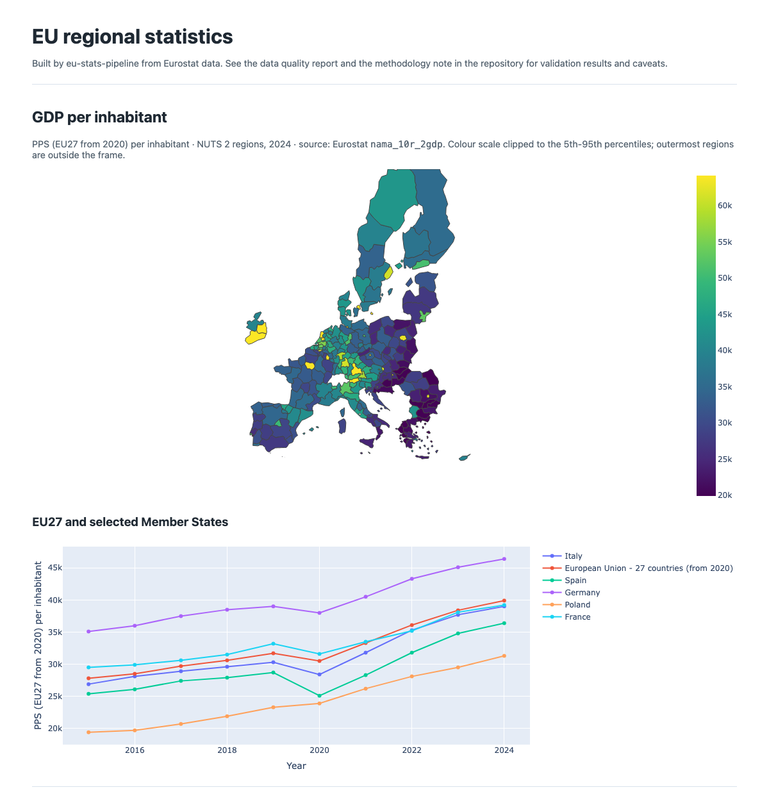

# eu-stats-pipeline

A small, reproducible statistical production pipeline for EU regional data. It downloads Eurostat datasets through the SDMX API and records the lineage of every file. It then validates the data with explicit, documented rules and publishes three outputs: a data quality report, a data dictionary and a dashboard.



## What it does

```
Eurostat SDMX API ─┐
GEO / OBS_FLAG     ├─► data/raw (+ manifest.json) ─► DuckDB raw ─► dbt staging ─► dbt marts ─► report, dictionary, dashboard
GISCO NUTS 2024 ───┘                                                  │
                                                            validation (dbt tests)
```

- **Ingestion with lineage.** It reads SDMX-CSV data and SDMX-ML codelists. Every file is stored with its source URL, retrieval time and SHA-256 checksum.
- **Modelling in dbt on DuckDB.** Typed staging views and analysis-ready marts, with a description for every model and column.
- **Validation.**
  - Structure, codelist conformity and plausibility ranges.
  - A coherence check: the regional population must sum to the national total.
  - Year-on-year changes that need a manual review.
  - NUTS version comparability.
- **Quality report** structured by the ESS quality dimensions. It reports flag shares (estimated, provisional, break in series), completeness, timeliness and every check result: [docs/quality-report.md](docs/quality-report.md).
- **Data dictionary** generated from the dbt project: [docs/data-dictionary.md](docs/data-dictionary.md).
- **Dashboard.** A static HTML page with NUTS 2 maps and national time series (`site/index.html`).

The methods, the validation rules and what they found are described in the [methodology note](docs/methodology.md). Among the findings: Eurostat's regional tables mix NUTS 2021 and NUTS 2024 codes, which double counts regional totals unless handled.

## Run it

Requires Python 3.11+.

```bash
python -m venv .venv && source .venv/bin/activate
pip install -r requirements-dev.txt -e .

eustats run              # live Eurostat data: ingest, load, dbt build, report
eustats run --offline    # same pipeline on the sample files in tests/fixtures
```

Individual steps: `eustats ingest | load | build | report`. Use `--out DIR` to write the outputs somewhere other than the repository.

## Tests

```bash
pytest -q          # unit tests and an offline end-to-end run, including all dbt checks
ruff check src tests
```

CI runs both on every push. A scheduled workflow runs the pipeline on live data once a month and uploads the outputs for review.

## Project layout

```
config/datasets.yml   indicators, SDMX keys, plausibility ranges
src/eustats/          ingestion, loading, report, dictionary, dashboard, CLI
dbt/                  staging and mart models, data tests, reference seeds
docs/                 methodology, quality report and data dictionary (latest live run)
tests/                pytest suite and offline fixtures
```

## Data sources

Eurostat data © European Union, reused under the Eurostat copyright notice. NUTS boundaries © EuroGeographics, distributed by GISCO. See the [methodology note](docs/methodology.md#sources-and-reuse).

## License

MIT
